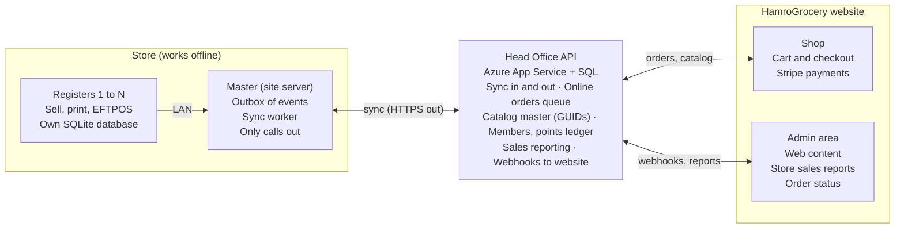
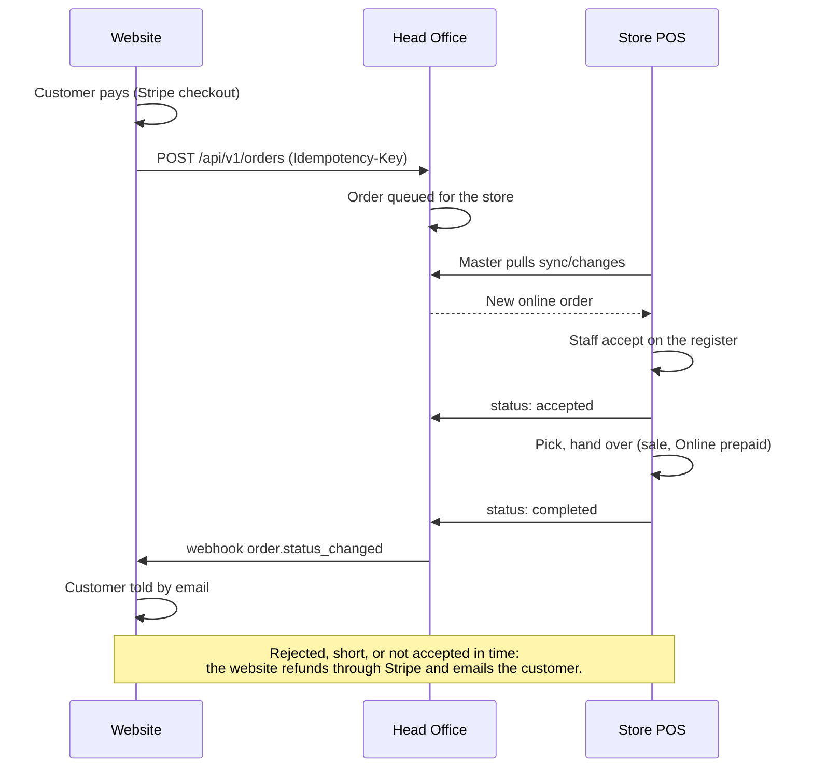

# NepPOS ↔ HamroGrocery Integration Design

Status: agreed design, not built yet · Owner: Subash · Last updated: 2026-11-14

This file is the master copy of the integration design. Change it by pull request, in the same PR as the code it describes.
The website side lives in [ShrSubash/HamroGrocery](https://github.com/ShrSubash/HamroGrocery); its setup notes are in `HamroGrocery/docs/neppos-integration.md`.

## Goal and scope

NepPOS and HamroGrocery are linked through a **Head Office API** in the cloud and never talk to each other directly. The store POS runs offline behind the shop's internet connection, as the NepPOS architecture (v2.2, sections 4 and 7.2) already plans.

What the link must let people do:

| Who | Can do | Where |
| --- | --- | --- |
| Customer | Browse products with real store prices and stock, order for pickup or delivery, pay online | HamroGrocery website |
| Customer | See and use the same loyalty points online and in store | Website and POS |
| Staff | Get online orders on the register, accept, pick, hand over | NepPOS register |
| Owner | Change a product or price once and have it reach the POS and the website | Head Office (via the website admin) |
| Owner | See store sales, Z reports, departments and best sellers from anywhere | HamroGrocery admin area |

Out of scope for the first release: delivery apps (Uber Eats, DoorDash), several stores sharing stock, and paying online for in-store sales. The design leaves room for all three.

Starting point: HamroGrocery is an ASP.NET Core 9 MVC site on MySQL, with Stripe checkout, an admin area (products, inventory, orders, purchase orders, reports) and a loyalty program.

## Architecture

There are three parts, and the Head Office API sits in the middle. The store only ever calls out, so it needs no open ports and keeps selling with the internet down. The website never reaches into the store's database.



Head Office (`src/NepPOS.HeadOffice.Api`) is the "Head Office (Cloud)" level in NepPOS architecture section 4. One Head Office serves every POS customer: each business is a tenant with its own stores and registers ([ADR 0001](../adr/0001-separate-products-shared-head-office.md)).

NepPOS and HamroGrocery are separate products. HamroGrocery works on its own, and a customer with both switches on *Connect to NepPOS* in the website admin. While connected, Head Office owns product names and prices; while not, the website owns everything. A delivery app added later plugs in the same way.

## Data ownership

Every kind of record has exactly one owner, the only system allowed to change it. The others hold read-only copies that sync. This is what stops the two systems overwriting each other.

| Record | Owner (writes it) | Copies (read only) | Why |
| --- | --- | --- | --- |
| Product code, name, price, category, GST, barcode | Head Office | POS, website | The owner changes a price once; it reaches every channel |
| Web-only content: photos, description, SEO, featured | Website | none | Only the website shows it |
| Stock on hand | Store POS | Head Office, website | Stock is physical and lives in the store; online orders reserve it |
| POS sales, Z reports, journal | Store POS | Head Office | Append-only; needed for GST and audit (NepPOS architecture section 6) |
| Online order: items, customer, payment | Website | Head Office, POS | Created and paid (Stripe) on the website |
| Online order: fulfilment status | Store POS | Head Office, website | Staff accept, pick and hand over at the store |
| Customers (members) | Head Office | POS, website | One customer whether they shop online or in store |
| Loyalty points | Points ledger (events from POS and website) | Head Office adds them up | Points are earned in both places; a ledger never loses an event |

**Matching products.** Head Office gives every product a GUID. NepPOS and HamroGrocery each store it as `ExternalId` beside their own ids (HamroGrocery keeps its `int` ids). The first import matches existing products by barcode, then by SKU; anything unmatched goes on a list for the owner.

**Loyalty.** NepPOS architecture says the store database is the source of truth for points. With a website as well, that becomes a ledger: each sale or redemption, online or in store, is a points event with its own GUID, and the balance is their sum. The POS can still award points offline.

## Online orders into the POS

An online order is paid on the website, waits at Head Office until the store's Master collects it, and becomes an ordinary NepPOS sale when it is handed over. That is what puts it in the Z, the GST figures and the stock count.



- **Register screen:** a new *Online orders* button with a count and a sound for each new order. Opening an order shows its items, pickup or delivery details and notes, with **Accept** and **Reject (reason)** buttons.
- **Picking:** each line can be marked *picked*, *short* or *substituted*. Any change goes back to the website, which refunds the difference.
- **Handover:** the order opens in the cart as a sale already paid with tender *Online (prepaid)*. Completing it prints the tax invoice and sends `completed` back up.
- **Pay at pickup** (no Stripe) works the same way, except the cashier takes cash or card at handover like any other sale.

## POS sales and stock on the website

Store sales reach the owner's website within about a minute when the shop is online, and catch up by themselves after an outage. Nothing at the till ever waits for the internet.

1. When a sale completes, NepPOS saves the sale **and** an outbox event (`sale.completed`, GUID id) in the same database transaction. The same happens for `day.closed` (the Z), `stock.changed` and `points.changed`.
2. A background sync worker on the store's Master sends unsent outbox events to Head Office in batches (`POST /api/v1/sync/events`), oldest first, and marks them sent when Head Office confirms.
3. Head Office stores each event once: a repeated event id is accepted and ignored, so a retry after a dropped connection never doubles a sale.
4. Head Office keeps the reporting tables up to date (sales by day, department, product, hour, employee; Z history), using the same calculations as the NepPOS Reports screen.
5. The HamroGrocery admin area gets a **Store sales** section that reads Head Office's reporting API. The owner sees store and online sales side by side, per store and per day, with the same headline figures as the register.
6. Stock changes go the same way, then Head Office tells the website (`stock.changed` webhook), so the product page shows what the store actually has.

If the shop is offline, events wait in the outbox (no limit, nothing lost) and the website shows the last stock it received.

## API contracts

There is one versioned REST API (`/api/v1`) on Head Office. The store and the website call it, and Head Office calls the website back through webhooks. The store never accepts incoming calls.

| Caller | Endpoint | Purpose |
| --- | --- | --- |
| Store (Master) | `POST /api/v1/sync/events` | Push a batch of outbox events (sales, Z, stock, points) |
| Store (Master) | `GET /api/v1/sync/changes?cursor=` | Pull what changed since the last pull: products, prices, members, new online orders. Returns `nextCursor` |
| Store (Master) | `POST /api/v1/orders/{orderId}/status` | Accepted, rejected (reason), picking, ready, completed, with any item changes |
| Store (Master) | `POST /api/v1/stores/{storeId}/heartbeat` | Every minute; tells the website the store can take orders |
| Website | `POST /api/v1/orders` | Send a paid order. `Idempotency-Key` header = the website's order GUID |
| Website | `GET /api/v1/catalog/changes?storeId=&after=` | Products and prices changed after a change number (`after=0`: everything). Web content stays on the website. Types: `NepPOS.Contracts.Catalog`; see `events.md` |
| Website | `GET /api/v1/stock?storeId=` | Stock on hand per product, for a full refresh |
| Website | `GET /api/v1/stores` | The business's stores: online (heartbeat in the last 10 minutes), last seen, last sale |
| Website | `GET /api/v1/reports/sales?storeId=&from=&to=` | One store's sales for trading days `from`–`to` (5 am cut-off, store's time zone): totals, tenders, and by day, department, product, hour and employee. Types: `NepPOS.Contracts.Reports` |
| Website | `GET /api/v1/members/{id}/points` and `POST .../points/redeem` | Balance, and a redemption held for an order |
| Head Office → website | Webhooks `order.status_changed`, `stock.changed`, `product.changed` | Push changes; retried with back-off until the website answers 2xx |

Every sync event has the same envelope:

```json
{
  "eventId": "5f0c2a8e-6a3e-4c1b-9a51-2d1c7e0b9f41",
  "type": "sale.completed",
  "version": 1,
  "storeId": "STORE-001",
  "registerId": "REG-001",
  "sequence": 1842,
  "occurredAtUtc": "2026-11-14T09:12:44Z",
  "payload": { "saleId": "…", "invoiceNumber": 1142, "lines": [], "payments": [] }
}
```

`eventId` makes a retry safe; `sequence` (per register, gapless, as the NepPOS journal already does) lets Head Office spot a missing event; `version` lets a payload change without breaking older registers.

In NepPOS, an online order is completed as a normal sale with a new tender, **Online (prepaid)**. That way it gets a tax invoice number, counts in the Z and the reports, and stays out of the cash drawer total.

## Security, offline and failures

Card data never leaves Stripe and the EFTPOS terminal, the store never opens a port to the internet, and every message can be retried safely.

**Security**

- A business's website gets a website key (`nwk_…`) from the admin endpoints. It can only read that business's stores and reports; a register key (`npk_…`) can't read reports, and a website key can't send events.
- Each register gets its own API key from a one-time activation code ([ADR 0002](../adr/0002-register-api-keys.md)). The key alone decides which business, store and register is calling, so a stolen key can't read or write another store's data, and it can be revoked on its own. The website gets its own key when it connects.
- HTTPS only. Webhooks carry an HMAC-SHA256 signature and a timestamp; the website rejects anything unsigned or more than 5 minutes old.
- Stripe stays on the website, so Head Office and NepPOS stay out of card-data (PCI) scope, as they are today with EFTPOS.
- Secrets live in a vault: Azure Key Vault for Head Office and the website, Windows DPAPI on the store PC. NepPOS architecture section 9 already requires this.

**When something fails**

| What fails | What happens |
| --- | --- |
| Shop internet is down | Registers keep selling. Events wait in the outbox. New online orders wait at Head Office. After 10 minutes with no heartbeat, the website stops offering pickup from that store |
| Head Office is down | Registers keep selling. The website takes no new orders and says so; it never takes payment for an order it cannot pass on |
| An order isn't accepted in time | After a set time (e.g. 15 minutes), Head Office cancels it, and the website refunds through Stripe and emails the customer |
| An item is out of stock when picking | Staff mark the line short or substituted; the website refunds the difference automatically |
| The same message arrives twice | Ignored, by `eventId` or `Idempotency-Key` |
| Stock on the website is a little old | The website keeps a small safety buffer per product (e.g. 2) so it doesn't oversell |

Open questions: the order acceptance time, the stock buffer, and whether the 10-minute heartbeat limit suits a quiet store.

## Build plan

The build runs in eight steps, each small enough to merge and test on its own. Online ordering works from step 6 and store sales show on the website from step 7. Each step depends on the ones before it.

| # | Step | Repo | Status / done when |
| --- | --- | --- | --- |
| 1 | **Outbox in NepPOS**: `OutboxMessages`, written in the same transaction as each sale and journal line | NepPOS | Done (PR #25) |
| 2 | **Head Office API**: tenants, stores, registers; one-time activation codes and per-register API keys; `sync/events` (each event stored once) and heartbeat | NepPOS | Done (PR #26) |
| 3 | **Store sync worker**: register activation screen, background push of the outbox, heartbeat, with back-off | NepPOS | Done (PR #27) |
| 4 | **Shared contracts package**: `NepPOS.Contracts` published to GitHub Packages | NepPOS | Deferred until online orders: the website copies the few types it reads until then |
| 5 | **Connect to NepPOS in HamroGrocery**: settings page, off by default; the website works exactly as before until it's on | HamroGrocery | Switching it on and off changes nothing for a web-only shop |
| 6 | **Catalog link**, part 1 (NepPOS): product GUIDs, `product.changed` events, Head Office catalog, `GET /api/v1/catalog/changes`. Part 2 (HamroGrocery): `ExternalId` columns, barcode/SKU matching, a background job that applies changes. All POS products go across; the website hides what it doesn't sell | Both | Part 1: this PR. Done when a price changed on the register shows on the website within a few minutes |
| 7 | **Online orders end to end**: Online orders panel on the POS, tender Online (prepaid), status webhooks and emails | Both | A test order goes from checkout to handover, with a Z that counts it |
| 8 | **Store sales on the website** (brought forward, built next): website keys, `GET /api/v1/stores` and `GET /api/v1/reports/sales` in Head Office; *Connect to NepPOS* and a Store sales page in the website admin | Both | The admin page matches the register's Reports screen for the same day |
| 9 | **Customers and points**: members, points ledger, points at the till and online | Both | Points earned in store show online within a minute, and the reverse |

Next after the catalog link: **NepPOS Portal** (`NepPOS.Portal`, same repo and database as Head Office): businesses, stores and registers on screens instead of curl, subscriptions (plan, register limit, expiry, status, enforced by Head Office without ever stopping a sale) and support tickets.

Later, only if the business needs it: a multi-tenant website, Stripe Connect.


## Running Head Office on a developer PC

```bash
cd src/NepPOS.HeadOffice.Api
dotnet user-secrets set "HeadOffice:AdminKey" "<24+ random characters>"
dotnet run --launch-profile http
```

It listens on `http://localhost:5180`, keeps its data in `headoffice.db` (SQLite) next to the project, and describes its API at `/openapi/v1.json`. `NepPOS.HeadOffice.Api.http` has every request ready to send from Visual Studio. In Azure it uses SQL Server: set `HeadOffice:DatabaseProvider` to `SqlServer` and `ConnectionStrings:HeadOffice`.

## Connecting a register

1. Create the business, store and an activation code in Head Office (admin endpoints; `NepPOS.HeadOffice.Api.http` has them ready).
2. On the register: **Manage → ☁️ Head Office**, enter the Head Office address and the code, then **Connect**. The code must be for the store the register is set up as (`STORE-001` today); Head Office refuses a mismatch without using the code up.
3. The register keeps its API key encrypted (Windows DPAPI) in `%LOCALAPPDATA%\NepPOS\head-office.json` and starts sending: the outbox every 10 seconds (500 events at most per call, oldest first) and a heartbeat every minute. After a failure it waits 20 s, 40 s… up to 5 minutes between tries.
4. Events Head Office refuses are put aside (`RejectedAtUtc`, with the reason) and shown on the screen; they are not sent again. A revoked key shows "no longer accepted": connect again with a new code.

## How to keep it documented

Documentation lives in the repos, next to the code it describes, so a change to the API and a change to its docs arrive in the same pull request.

| What | Where | Kept current by |
| --- | --- | --- |
| Integration overview (this design) | `NepPOS/docs/integration/README.md` (this file) | Updated in the PR that changes a decision |
| Decisions, one per file: why Head Office sits in the middle, why GUIDs and an outbox, who owns the catalog | `NepPOS/docs/adr/` (Architecture Decision Records), e.g. `0001-separate-products-shared-head-office.md` | Never edited after merge; a new ADR replaces an old one |
| The API itself | `NepPOS/docs/api/headoffice-v1.json`, generated by the Head Office project's OpenAPI support on every build | The build; a test fails if the committed file is out of date |
| Every event and webhook: name, version, fields, a JSON example | `NepPOS/docs/integration/events.md` | Same PR as the event change |
| Setting up the website: URLs, client id, webhook secret, product matching | `HamroGrocery/docs/neppos-integration.md` | Same PR as the HamroGrocery change |
| API changes by version | `NepPOS/docs/api/CHANGELOG.md` | Every PR that touches `/api` |

Rules that keep it honest:

- `/api/v1` only ever gains things (new fields, new endpoints). Removing or renaming anything means `/api/v2`, with v1 kept running until every store has updated.
- Both repos use the same `NepPOS.Contracts` package, so a payload that doesn't match its documented shape fails to compile, not in a customer's order.
- Add a pull request template to both repos with two ticks: *docs/api or events.md updated* and *ADR added if a decision changed*.
- Contract tests in HamroGrocery post the example payloads from `events.md` to its webhook endpoints, so the docs and the code can't drift apart.
